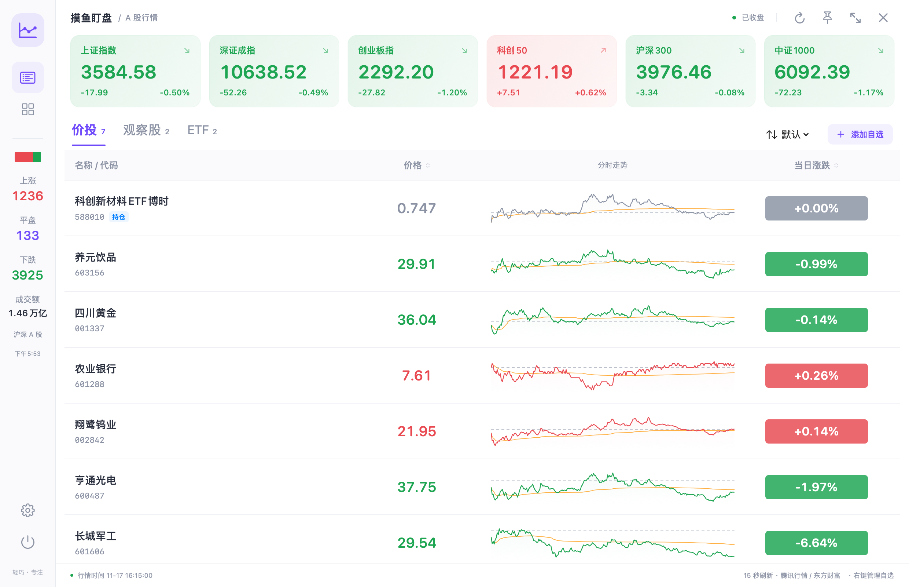
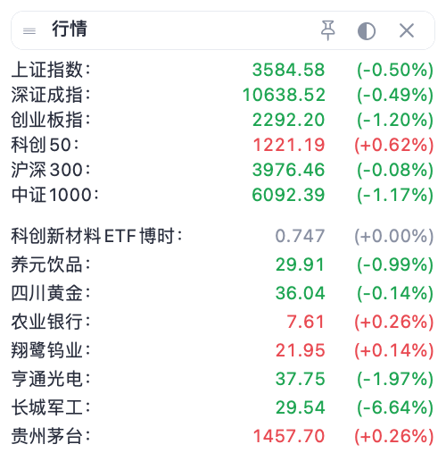

<p align="center">
  
</p>

<h1 align="center">摸鱼盯盘 · Moyu Ticker</h1>

<p align="center">把行情放进菜单栏，自选涨跌，抬眼可见。</p>
<p align="center">macOS 13+ · Apple Silicon & Intel · SwiftUI + AppKit</p>

摸鱼盯盘是一款原生 macOS 菜单栏 A 股行情工具。菜单栏查看价格与涨跌，悬停展开轻量自选列表，点击进入完整行情窗口。支持指数、股票和 ETF，以及分时、日 K、周 K、月 K 查看。

## 下载与安装

**[下载 macOS 通用安装包 · v1.0.1](https://github.com/quq603654536/moyu-ticker/releases/download/v1.0.1/MoyuTicker-1.0.1-universal-macOS.zip)** · [查看所有版本](https://github.com/quq603654536/moyu-ticker/releases)

一个安装包同时包含 **Apple Silicon（M 系列 / arm64）和 Intel（x86_64）** 两种架构，支持 **macOS 13 及以上**，无需安装 Xcode 或自行编译。

1. 下载上面的 ZIP 安装包并解压。
2. 将「摸鱼盯盘.app」拖到「应用程序」文件夹。
3. 双击打开，在屏幕顶部菜单栏查看行情；以后可从启动台搜索「摸鱼盯盘」。

安装包采用本机临时签名，尚未经过 Apple 公证。首次打开如提示无法验证开发者，请在确认下载来源可信后，按照 [Apple 官方说明](https://support.apple.com/zh-cn/102445)，在「系统设置 → 隐私与安全性」中允许打开该应用。

Release 同时提供 `SHA256SUMS.txt`，可核对下载文件的 SHA-256 校验值。

## 看一眼，就够了

- **菜单栏轮播**：多选指数和自选股，每 3 秒循环展示，文字上下平滑滚动。
- **悬停速览**：停留 1 秒，展开指数与自选列表，直接查看名称、现价、涨跌幅。
- **透明悬浮窗**：一键固定、自由拖动，也可以隐藏背景，只保留行情文字。
- **完整个股详情**：分时、日 K、周 K、月 K，支持成交量、MA5 / MA10 / MA20，以及历史行情悬停查看。
- **自选管理**：中文名称、代码或拼音搜索；分组、排序、持仓标记和右键操作。
- **本地保存**：自动保留自选、显示偏好及行情缓存，支持登录 Mac 时启动。

## 界面预览



<details>
<summary>展开查看紧凑悬停列表</summary>



</details>

截图使用示例自选与行情，仅展示产品界面。

## 从源码构建

需要 macOS 13 或更高版本，以及 Apple Command Line Tools 或 Xcode。通用构建同时支持 M 系列与 Intel Mac，无第三方运行时依赖。

```sh
# 尚未安装开发工具时执行
xcode-select --install

# 获取源码
git clone https://github.com/quq603654536/moyu-ticker.git
cd moyu-ticker

# 构建 Apple Silicon + Intel 通用版本
bash scripts/build.sh

# 打开应用
open "dist/摸鱼盯盘.app"
```

只需要当前 Mac 架构时，可运行 `bash scripts/build.sh --current-arch`。

构建产物：

- `dist/摸鱼盯盘.app`：应用程序。
- `dist/摸鱼盯盘-macOS.zip`：应用压缩包。

将应用拖入「应用程序」文件夹后，即可在启动台搜索「摸鱼盯盘」。应用常驻菜单栏，不占用 Dock；关闭行情窗口后仍会继续运行。右键菜单栏图标可以退出。

也可以运行 `bash 启动摸鱼盯盘.command`：优先打开已安装的版本，未安装时打开本地构建；缺少构建产物时自动构建当前架构。

构建脚本采用本机临时签名，签名与首次打开说明见上方「下载与安装」。

## 使用方式

| 操作 | 效果 |
| --- | --- |
| 鼠标悬停菜单栏行情 1 秒 | 展开紧凑行情列表 |
| 左键点击菜单栏行情 | 打开缩小后的完整行情窗口 |
| 右键点击菜单栏行情 | 打开刷新、设置和退出菜单 |
| 点击股票或指数 | 进入分时与 K 线详情 |
| 点击悬浮窗图钉 | 固定窗口，可拖动标题移动位置 |
| 点击半圆图标 | 切换透明背景 |

在「偏好设置 → 显示行情」中勾选多项即可轮播；只选一项时固定显示。轮播顺序遵循勾选顺序，至少保留一项。轮播只切换本地已有行情，不增加网络请求。

默认按顺序展示上证指数、上涨领先（上证黄线指标）、深证成指、创业板指、科创 50 和中证 1000。上涨领先采用东财上证分时图的黄线数据，约每分钟更新，支持分时与菜单栏轮播；涨跌以该分时数据的昨收基准计算，不提供独立 K 线。原先菜单栏选择的沪深 300 会迁移为上涨领先，自选中的沪深 300 ETF 不受影响。股票 K 线支持前复权 / 不复权，指数与 ETF 使用不复权口径。

### 快捷键

| 快捷键 | 操作 |
| --- | --- |
| `⌘R` | 刷新行情 |
| `⌘F` | 搜索并添加自选 |
| `⌘,` | 打开偏好设置 |
| `⌘W` | 关闭当前窗口 |
| `Esc` | 返回自选或收起窗口 |
| `⌘Q` | 退出应用 |

## 行情来源与刷新

| 内容 | 来源 | 更新方式 |
| --- | --- | --- |
| 股票、ETF、指数报价 | 腾讯财经 | 默认每 15 秒，可选 5 / 10 / 15 / 30 / 60 秒 |
| 当日分时、历史 K 线 | 腾讯财经 | 按需约每 60 秒更新 |
| 上涨领先（上证黄线指标） | 东方财富 | 约每 60 秒，支持备用节点与缓存状态 |
| 沪深上涨 / 平盘 / 下跌家数、市场成交额 | 东方财富 | 约每 60 秒，支持备用节点 |

行情以数据源返回的时间为准。数据源可能延迟或暂时不可用，应用会保留缓存并提示更新状态；备用统计节点返回的数据会标记为「延时统计」。市场广度统计覆盖沪深 A 股，不含北交所。

「偏好设置 → 接口日志与失败率」提供最近 7 天的本地统计，分别展示网络请求和最终数据更新的失败比例，并可打开日志目录。

应用提供行情查看，不接入交易账户或下单功能。展示数据仅供参考，不构成投资建议。

## 隐私与本地数据

- 自选、持仓标记、偏好和行情缓存保存在本机。
- 获取行情会向对应数据源发送证券代码，搜索会发送输入的关键词。
- 请求日志只保存在本机，记录接口分类、时间、耗时、状态和错误码，不记录自选代码、搜索词或响应内容。
- 构建产物、运行日志、本地环境配置与个人数据不纳入源码仓库。

## 开发与验证

代码分为 `Sources/MarketCore`（数据模型、接口与解析）和 `Sources/TickerBar`（SwiftUI 界面、AppKit 菜单栏及窗口）。

```sh
# 公开行情样本解析与请求日志统计测试
bash scripts/test.sh

# 额外检查在线行情接口
bash scripts/test.sh --live

# 使用隔离偏好设置进行应用检查，并输出界面截图
"dist/摸鱼盯盘.app/Contents/MacOS/TickerBar" --verify /tmp/moyu-ticker-verification
```

应用验证使用独立的示例自选与日志目录，不修改实际自选或启用开机启动。`Package.swift` 可供 Xcode 打开源码；仅安装 Command Line Tools 时，可使用项目附带的构建脚本。

## 反馈与贡献

欢迎通过 [Issues](https://github.com/quq603654536/moyu-ticker/issues) 反馈问题、提出建议，或提交 Pull Request。报告问题时，请附上 macOS 版本、芯片类型及复现步骤，并去掉日志或截图中的个人信息。
